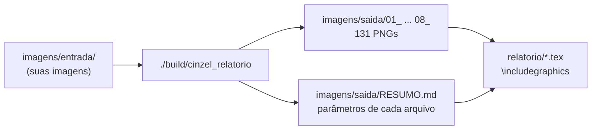
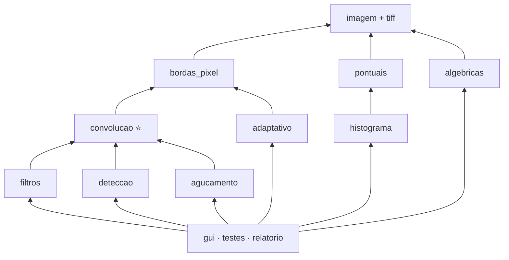

# Guia do Sistema Implementado — Cinzel

O que foi implementado, como rodar os testes e onde está cada imagem para o relatório.
O guia didático para reimplementar com calma continua em [GUIA_IMPLEMENTACAO.md](GUIA_IMPLEMENTACAO.md).

---

## 1. Rodar tudo (direto ao ponto)

Na raiz do projeto:

```bash
cmake -S . -B build -DCMAKE_BUILD_TYPE=Release    # configurar (só na primeira vez)
cmake --build build -j                            # compilar

./build/cinzel_testes      # 1) testes unitários: confere os cálculos feitos à mão
./build/cinzel_relatorio   # 2) gera TODAS as imagens do relatório em imagens/saida/
./build/cinzel             # 3) abre a interface gráfica
```

Saída esperada:

```
./build/cinzel_testes     →  82 de 82 verificacoes passaram.  TODOS OS TESTES PASSARAM.
./build/cinzel_relatorio  →  131 imagens geradas em .../imagens/saida
```

O passo 2 leva uns 2 segundos e pode ser repetido quantas vezes quiser (sobrescreve tudo).
Depois dele, abra **`imagens/saida/RESUMO.md`**, que lista cada arquivo gerado com os parâmetros,
as máscaras e a imagem de entrada usada.



---

## 2. Onde está cada coisa para o relatório

Todas as pastas abaixo ficam em `imagens/saida/`.

| Pasta | Item da especificação | Entrada usada | O que tem |
|---|---|---|---|
| `01_algebricas` | Dissolve uniforme e não uniforme | lena_gray_512 + macaco | $t = 0{,}25;\ 0{,}5;\ 0{,}75$; rampa e radial (+ mapas de pesos) |
| `02_intensidade` | Negativo, contraste, limiar, gamma, log | mamografia, polymersomes, limiar, fratura, washed, hubble | resultado + **curva** $s = T(r)$ de cada operação |
| `03_histograma` | Expansão e equalização | polymersomes, regiao, sol2, washed | cada imagem + desenho do histograma (`*_hist.png`) |
| `04_contraste_adaptativo` | Contraste adaptativo ($c$, $n$) | sol2 | 4 combinações de $c$ e $n$ + média e desvio locais |
| `05_filtragem` | Média e mediana ($n$ = 3, 5, 7) | lena_gray_256 + 5% sal-e-pimenta | + comparação das **4 estratégias de borda** (média 25×25) |
| `06_deteccao_bordas` | Roberts, Sobel, Kirsch, Laplaciano | cameraman | $G_x$, $G_y$, magnitude; as 8 respostas do Kirsch + máximo |
| `07_agucamento` | Laplaciano e high boost | lua, cameraman | resposta do Laplaciano **separada** + imagem aguçada; $k$ = 1, 2, 4 |
| `08_testes_convolucao` | **Testes obrigatórios 2.1, 2.2, 2.3** | cameraman | `t21_*`, `t22_*`, `t23_*` |

### Testes obrigatórios (seção 2 da especificação)

| Arquivo | Teste | Parâmetros |
|---|---|---|
| `t21_c1_d1.png` … `t21_c3_d1.png` | 2.1 aguçamento | $(c,d)$ = (1,1) obrigatório, (1,2), (1,4), (2,1), (3,1) |
| `t22_h1_offset128.png`, `t22_h2_offset128.png` | 2.2 relevo | offset 128 (cinza = sem variação) |
| `t22_h*_offset0.png` | 2.2 relevo | sem offset: os negativos viram 0 |
| `t22_h*_offset128_correlacao.png` | 2.2 relevo | sem rotacionar a máscara: o relevo **inverte** |
| `t23_h3_*.png`, `t23_h4_*.png` | 2.3 bordas | cada um com faixa saturar / absoluto / normalizar |

### Observações que já aparecem nos resultados (úteis para a discussão)

- **2.1:** com $d = 1$ a soma da máscara é 1, então o brilho médio se mantém e as bordas são realçadas.
  Aumentar $d$ clareia a imagem toda (soma $= d > 1$). Aumentar $c$ intensifica o realce e o ruído.
- **2.2:** $h_1$ e $h_2$ somam 0, então regiões uniformes ficam no cinza do offset. Na versão por
  correlação, claro e escuro trocam de lado, porque rotacionar a máscara 180° inverte a direção da "luz".
- **2.3:** $h_4$ soma $-8$: uma região uniforme de valor $v$ vira $-8v$. Por isso `t23_h4_saturar.png`
  é **toda preta** e só `t23_h4_normalizar.png` mostra a estrutura (bom exemplo para a questão 8).
  $h_3$ soma 2 e é assimétrica, então mantém parte da imagem e realça bordas em uma direção.
- **Histograma:** em `regiao` (só dois níveis de cinza) a expansão leva para 0/255, mas a equalização
  não "cria" níveis novos: o histograma continua com duas barras (questão 9). Em `sol2` a expansão
  quase não muda nada (a imagem já vai de 0 a 249), enquanto a equalização clareia muito.
- **Filtragem:** a mediana 3×3 remove quase todo o sal-e-pimenta; a média só espalha o ruído (questão 3).
- **Bordas da imagem:** em `bordas_media25_zero.png` aparece uma moldura escura; com replicar,
  refletir ou circular, não.
- **Kirsch:** `K0 (N)` acende nas bordas horizontais e `K2 (L)` nas verticais; o máximo combina tudo.

---

## 3. Interface gráfica (`./build/cinzel`)

```
┌ Controles ──────────────┬ Imagens ──────────────────────────────────────┐
│ Arquivo: [cameraman ▼]  │  Original            Resultado                │
│ Operação: [Sobel    ▼]  │  [imagem]            [imagem]                 │
│ Parâmetros (sliders)    │  [histograma]        [histograma]             │
│ Borda: [Replicar ▼]     │                                               │
│ [x] Aplicar automático  │  Respostas intermediárias                     │
│ [Aplicar]               │  [Gx] [Gy] [Magnitude]   /  [K0]…[K7] [Máximo]│
│ [Usar resultado como    │                                               │
│  entrada]               │                                               │
│ [Salvar resultado...]   │                                               │
└─────────────────────────┴───────────────────────────────────────────────┘
```

- **Arquivo**: lista as imagens de `imagens/entrada/` (inclusive TIFF).
- **Operação**: as 19 operações. Com "Aplicar automaticamente" ligado, mexer num slider recalcula na hora.
- **Passe o mouse sobre qualquer imagem**: aparece o valor do pixel e a **vizinhança 3×3**.
  Use isso na arguição para comparar um cálculo à mão com o sistema.
- **Convolução genérica**: grade editável de até 9×9, offset, faixa, borda, opção de rotacionar
  (convolução × correlação) e botões com as máscaras **2.1 (com c e d), h1, h2, h3, h4**.
- **Dissolve**: aparece um segundo seletor de arquivo para $f_2$ (precisa ter o mesmo tamanho).
- **Salvar resultado e respostas**: grava em `imagens/saida/gui/`.
- **Usar resultado como entrada**: encadeia operações (ex.: equalizar e depois Sobel).

---

## 4. O que foi implementado

### Arquivos do núcleo (`src/core/`, tudo que é avaliado)

| Arquivo | Conteúdo | Funções principais |
|---|---|---|
| `imagem.hpp/.cpp` | Tipos `Imagem` (8 bits) e `ImagemF` (float), `Faixa`, `Resultado`, leitura/escrita | `paraFloat`, `paraUint8`, `carregar`, `salvar` |
| `tiff.cpp` | Leitura de TIFF com a libtiff (o stb não lê TIFF) | `carregarTIFF` |
| `bordas_pixel.hpp/.cpp` | Pixel fora da imagem | `pixelComBorda` |
| `mascaras.hpp` | `Mascara` + todas as máscaras (Sobel, Roberts, Kirsch, Laplaciano, testes) | `mascaras::kirsch(k)`, `agucamentoCD(c,d)`… |
| `convolucao.hpp/.cpp` | Convolução genérica | `convoluir`, `convolucaoGenerica` |
| `pontuais.hpp/.cpp` | Negativo, limiar, contraste, gamma, log (via LUT) | `negativo`, `limiarizar`, `alargarContraste`, `potencia`, `logaritmo` |
| `algebricas.hpp/.cpp` | Dissolve cruzado | `dissolveUniforme`, `dissolveNaoUniforme`, `pesosRampaHorizontal`, `pesosRadial` |
| `histograma.hpp/.cpp` | Histograma | `histograma`, `expandirHistograma`, `equalizarHistograma`, `desenharHistograma` |
| `filtros.hpp/.cpp` | Média e mediana | `filtroMedia`, `filtroMediana` |
| `adaptativo.hpp/.cpp` | Contraste adaptativo | `contrasteAdaptativo` |
| `deteccao.hpp/.cpp` | Roberts, Sobel, Kirsch, Laplaciano | `roberts`, `sobel`, `kirsch`, `laplaciano`, `magnitudeGradiente` |
| `agucamento.hpp/.cpp` | Aguçamento | `agucarLaplaciano`, `highBoost` |

Outros executáveis:

| Arquivo | O que é |
|---|---|
| `src/testes/testes.cpp` | Testes unitários (`cinzel_testes`) |
| `src/testes/gerar_relatorio.cpp` | Gerador das imagens do relatório (`cinzel_relatorio`) |
| `src/gui/main.cpp` | Interface ImGui (`cinzel`); não tem nenhum algoritmo, só chama o núcleo |



### Decisões técnicas (escreva isto em "Materiais e métodos")

| Decisão | Como ficou | Onde |
|---|---|---|
| **Valores fora de [0,255]** | Cálculo em `float` (`ImagemF`) e conversão explícita no final: **Saturar** $\operatorname{clamp}(v,0,255)$, **Normalizar** $\frac{v - v_{\min}}{v_{\max}-v_{\min}}\cdot255$ ou **Absoluto** $\min(\lvert v \rvert,255)$. Nunca há cast direto (que faria $v \bmod 256$). | `paraUint8` em `imagem.cpp` |
| **Bordas** | 4 estratégias: Zero, Replicar, Refletir (espelho sem repetir a borda) e Circular. Todas as operações de vizinhança leem pixels por uma única função. | `bordas_pixel.cpp` |
| **Offset** | Somado **antes** da conversão de faixa: $g = \operatorname{Faixa}(f*h + \text{offset})$ | `convolucaoGenerica` |
| **Convolução × correlação** | A convolução genérica usa **convolução verdadeira** (máscara rotacionada 180°), com opção de desligar. Os operadores de borda (Sobel, Roberts, Kirsch, Laplaciano) usam **correlação**, para que as máscaras funcionem como estão escritas ($G_x > 0$ = fica mais claro para a direita). | `convoluir(..., rotacionar)` |
| **Centro da máscara** | $\left(\frac{n-1}{2}, \frac{m-1}{2}\right)$ com divisão inteira. Em tamanho ímpar é o centro exato; no Roberts 2×2 fica no canto superior esquerdo, então $G_x = f(x,y) - f(x{+}1,y{+}1)$. | `Mascara::centroLinha` |
| **Operações pontuais** | Todas montam uma **LUT** de 256 posições ($\texttt{lut}[r] = T(r)$) e aplicam pixel a pixel. | `aplicarLUT` |
| **Gamma** | $s = 255\,c\,(r/255)^{\gamma}$ | `potencia` |
| **Log** | $s = c\ln(1+r)$; com $c = 0$ usa $c = 255/\ln 256 \approx 45{,}99$ ($255 \mapsto 255$) | `logaritmo` |
| **Equalização** | $s_k = \operatorname{round}\big(255 \cdot \sum_{j\le k} h(j)/N\big)$ | `equalizarHistograma` |
| **Contraste adaptativo** | $g = m + \frac{c}{\sigma}(f - m)$ com $m$, $\sigma$ da vizinhança $n\times n$; se $\sigma = 0$, $g = f$ | `contrasteAdaptativo` |
| **Aguçamento Laplaciano** | $g = f + c\,\nabla^2 f$, com $c = -1$ porque o centro das máscaras (−4 ou −8) é negativo; o código decide $c$ olhando o sinal do centro | `agucarLaplaciano` |
| **High boost** | $g = f + k(f - \bar f)$, $\bar f$ = média $n\times n$ | `highBoost` |
| **Kirsch** | 8 máscaras geradas por código, girando o anel externo de $K_0$ ($[5,5,5,-3,-3,-3,-3,-3]$) 45° por vez. Resposta final = máximo das 8. | `mascaras::kirsch`, `kirsch` |
| **Cor → cinza** | Na leitura: $(77R + 150G + 29B)/256$ (mesmos pesos do stb_image) | `carregar`, `tiff.cpp` |
| **TIFF** | Lido pela **libtiff** (`TIFFReadRGBAImageOriented`), que decodifica qualquer variante (compressão, 1/8/16 bits, cinza, RGB, paleta) para RGBA; depois converte para cinza. Conferido contra o PIL nas 38 imagens TIFF da pasta: pixels idênticos. | `tiff.cpp` |

### Bibliotecas usadas (todas permitidas pela especificação)

| Biblioteca | Uso |
|---|---|
| stb_image / stb_image_write | Ler PNG/JPG/BMP, salvar PNG |
| libtiff | Ler TIFF |
| Dear ImGui + GLFW + OpenGL 3 | Interface e exibição |

Nenhuma biblioteca faz processamento: todo algoritmo avaliado está em `src/core/`.

---

## 5. O que os testes unitários conferem

`./build/cinzel_testes` roda 82 verificações, cada uma com valores calculados à mão:

| Grupo | Exemplos verificados |
|---|---|
| Conversão de faixa | $[-160, 0, 50, 300]$ → saturar $[0,0,50,255]$, absoluto $[160,0,50,255]$, normalizar $[0,89,116,255]$ |
| Pontuais | negativo do negativo = original; gamma $64 \to 128$ ($\gamma=0{,}5$), $64 \to 16$ ($\gamma=2$); log $10 \to 110$; contraste por partes |
| Dissolve | $0{,}75\cdot200 + 0{,}25\cdot40 = 160$; tamanhos diferentes geram erro |
| Histograma | expansão $[50,100,150] \to [0,128,255]$; equalização com 16 pixels → 96, 191, 255 |
| Bordas | linha $[10,20,30]$ em $x=-1$: zero 0, replicar 10, refletir 20, circular 30 |
| Convolução | Laplaciano no ponto claro = $-160$; máscara de deslocamento: convolução lê $f(x-1)$ e correlação lê $f(x+1)$; somas das máscaras dos testes 2.1–2.3 |
| Filtros | média do "sal" = 37, mediana = 10 |
| Adaptativo | exemplo do guia → 129; região uniforme não muda |
| Detecção | Sobel $G_x = 360$, $G_y = 0$; Kirsch: todas somam 0 e $K_2$ (L) vence numa borda vertical com 1350; Roberts; magnitude $\sqrt{3^2+4^2}=5$ |
| Aguçamento | $50 \to 210$; imagem uniforme não muda |
| Leitura | TIFF (PackBits, LZW, RGB, sem compressão), BMP e JPG abrem com o tamanho certo |

---

## 6. Pontos de atenção

- ⚠️ **Contraste adaptativo:** a especificação não dá a fórmula. Foi usada
  $g = m + \frac{c}{\sigma}(f - m)$. Se o material do professor usar outra, a troca é uma linha em
  `adaptativo.cpp` (a linha `g.at(x, y) = ...`).
- **Imagens grandes na interface:** a mediana com $n$ grande numa imagem de 1024×1024 pode levar
  alguns segundos. Desligue "Aplicar automaticamente" nesses casos.
- **Diferenças em relação ao [GUIA_IMPLEMENTACAO.md](GUIA_IMPLEMENTACAO.md):** o centro da máscara
  é $(n-1)/2$ (e não $\lfloor n/2\rfloor$; só muda em tamanhos pares), a estratégia "Ignorar" foi
  trocada por "Circular" e os arquivos TIFF são lidos com a libtiff.

---

## 7. Roteiro rápido para o relatório

1. `./build/cinzel_testes` → print da saída para "Materiais e métodos / validação".
2. `./build/cinzel_relatorio` → abra `imagens/saida/RESUMO.md`.
3. Para cada seção do relatório, pegue as imagens da pasta correspondente (tabela da seção 2).
4. "Materiais e métodos": copie as decisões da tabela da seção 4.
5. "Resultados/Discussão": use as observações da seção 2 e as 10 questões conceituais.
6. Um print da interface (`./build/cinzel`, por exemplo com Kirsch, mostrando as 8 respostas)
   serve para a subseção "Interface e fluxo de utilização".
