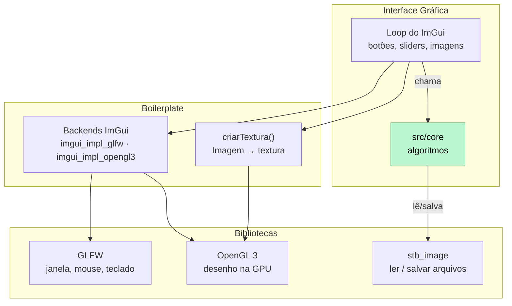

# Tecnologias

## Resumo da stack

| Camada            | Tecnologia                       | Papel                                            |
| ----------------- | -------------------------------- | ------------------------------------------------ |
| Linguagem         | **C++17** (g++ 13)               | Todo o processamento e a interface               |
| Build             | **CMake ≥ 3.16**                 | Compilação do projeto e download do ImGui        |
| Leitura/escrita   | **stb_image / stb_image_write**  | Abrir PNG/JPG/BMP e salvar PNG (header-only) |
| Leitura de TIFF   | **libtiff**                      | Abrir TIF/TIFF (o stb não lê TIFF)               |
| Interface gráfica | **Dear ImGui** + GLFW + OpenGL 3 | Painel de controles, imagens, histogramas        |
| Testes            | `assert` + executável próprio    | Conferir cálculos em matrizes pequenas           |
| Relatório         | LaTeX                            | PDF final                                        |
| Versionamento     | Git + GitHub                     | Entregável obrigatório                           |

**Regra da especificação:** bibliotecas só podem ser usadas para **ler, escrever, exibir
imagens e construir a interface**. Nenhuma função de processamento de bibliotecas
externas pode ser usada (nada de OpenCV, nem conversões que façam filtragem, etc.).
O stb não faz processamento nenhum, só decodifica arquivos.

---

## 1. Núcleo de processamento: C++17 puro

- Sem dependências: só a biblioteca padrão (`<vector>`, `<cmath>`, `<algorithm>`, `<cstdint>`).
- Imagem representada como `std::vector<uint8_t>` + largura + altura. É a estrutura mais
  simples possível, e fácil de explicar na arguição. Para uma imagem de largura $L$ e altura $A$:

$$
f(x, y) \;\longrightarrow\; \texttt{px}[\,y \cdot L + x\,], \qquad 0 \le x < L,\; 0 \le y < A,\; f(x,y) \in \{0, 1, \dots, 255\}
$$
- C++17 dá `std::clamp`, `std::filesystem` e structured bindings, que ajudam a deixar o código limpo.

## 2. Leitura e escrita: stb_image

- [`stb_image.h`](https://github.com/nothings/stb) e `stb_image_write.h`: um arquivo `.h` cada,
  basta copiar para `external/stb/`.
- `stbi_load(caminho, &w, &h, &canais, 1)`: o último parâmetro `1` força 1 canal (cinza).
  Isso é **leitura**, permitida pela especificação.
- `stbi_write_png(...)`: salvar resultados para o relatório.

## 3. Interface gráfica: Dear ImGui

### Como as peças se encaixam



### Por que ImGui?

**Escolha: Dear ImGui.** No modo imediato, a interface é redesenhada a cada frame, e um
controle é só um `if`:

```cpp
if (ImGui::SliderFloat("gamma", &gamma, 0.1f, 5.0f))
    resultado = potencia(original, 1.0f, gamma);   // recalcula ao mexer no slider
```

Não existem classes de janela, sinais/slots nem callbacks. Isso reduz bastante o código de
interface, e esse código **não é avaliado**. O único trecho "chato" é enviar a imagem para a
GPU como textura.

### O que precisa instalar

**SO utilizado**:  (Ubuntu 24.04) 

```bash
sudo apt install cmake libglfw3-dev libgl1-mesa-dev libtiff-dev
```

O próprio ImGui é baixado pelo CMake (`FetchContent`), sem instalação manual.

## 4. Ferramentas de apoio

- **VS Code** + extensão C/C++ (ou clangd) para autocompletar e depurar.
- **Ferramentas de visualização de imagens**: só para **comparar** visualmente resultados (caso dê algum erro na renderização).
- **Imagens de teste clássicas em cinza**: Lena, cameraman, moon, "pout" (baixo contraste),
  imagem com ruído sal-e-pimenta (para média × mediana).
