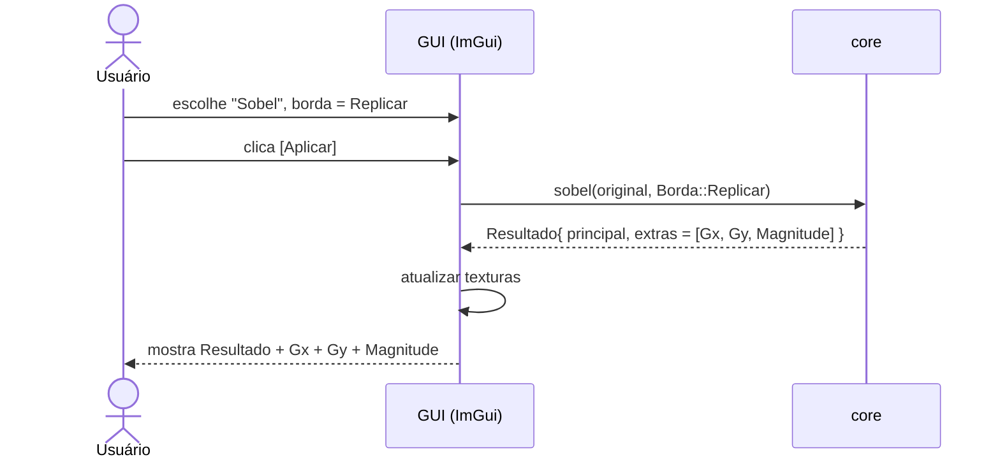

# Arquitetura e Decisões Técnicas

## 1. Estrutura de pastas

```
cinzel/
├── CMakeLists.txt
├── README.md                  # como compilar e usar
├── GUIA_IMPLEMENTACAO.md      # guia didático
├── docs/planejamento/         # estes documentos
├── external/
│   └── stb/                   # stb_image.h, stb_image_write.h
├── src/
│   ├── core/                  # ← TUDO que é avaliado mora aqui (sem dependência de GUI)
│   │   ├── imagem.hpp/.cpp        # tipos Imagem, ImagemF, conversões, leitura/escrita
│   │   ├── bordas_pixel.hpp/.cpp  # acesso a pixel fora da imagem (estratégias de borda)
│   │   ├── pontuais.hpp/.cpp      # negativo, limiar, contraste, gamma, log
│   │   ├── algebricas.hpp/.cpp    # dissolve uniforme e não uniforme
│   │   ├── histograma.hpp/.cpp    # cálculo, expansão, equalização
│   │   ├── convolucao.hpp/.cpp    # convolução genérica n×m + offset
│   │   ├── filtros.hpp/.cpp       # média, mediana
│   │   ├── adaptativo.hpp/.cpp    # contraste adaptativo
│   │   ├── deteccao.hpp/.cpp      # Roberts, Sobel, Kirsch, Laplaciano
│   │   ├── agucamento.hpp/.cpp    # Laplaciano, high boost
│   │   └── mascaras.hpp           # máscaras prontas (Sobel, Kirsch, testes 2.1–2.3)
│   ├── gui/
│   │   └── main.cpp               # ImGui: só chama funções do core e mostra resultados
│   └── testes/
│       ├── testes.cpp             # asserts com matrizes pequenas
│       └── gerar_relatorio.cpp    # gera em lote as imagens dos testes obrigatórios
├── imagens/
│   ├── entrada/
│   └── saida/
└── relatorio/                 # LaTeX + PDF
```

**Regra de ouro:** `src/core` não inclui nada de `imgui`, `GLFW` ou OpenGL. Assim:
- dá para testar algoritmos sem abrir janela;
- trocar a GUI não muda o núcleo;
- na arguição, o código mostrado é só o algoritmo, sem ruído de interface.

## 2. Tipos de dados

```cpp
// Imagem final, 8 bits: o que se lê, exibe e salva.
struct Imagem {
    int largura = 0, altura = 0;
    std::vector<uint8_t> px;               // tamanho = largura * altura
    uint8_t& at(int x, int y)       { return px[y * largura + x]; }
    uint8_t  at(int x, int y) const { return px[y * largura + x]; }
};

// Imagem intermediária em ponto flutuante: guarda negativos e valores > 255.
struct ImagemF {
    int largura = 0, altura = 0;
    std::vector<float> px;
    float& at(int x, int y)       { return px[y * largura + x]; }
    float  at(int x, int y) const { return px[y * largura + x]; }
};

// Máscara n (linhas) × m (colunas)
struct Mascara {
    int linhas, colunas;
    std::vector<float> v;                  // v[i * colunas + j]
    float at(int i, int j) const { return v[i * colunas + j]; }
};
```

### Layout na memória (row-major)

Para uma imagem de largura $L$, o pixel na coluna $x$ e linha $y$ fica no índice

$$
i = y \cdot L + x
$$

Exemplo com $L = 3$, $A = 3$ (os números são os índices do vetor):

<table style="border-collapse:collapse;text-align:center;font-family:monospace">
  <tr><td></td><td><b>x=0</b></td><td><b>x=1</b></td><td><b>x=2</b></td></tr>
  <tr><td><b>y=0</b></td><td style="border:1px solid #888;padding:6px 12px">0</td><td style="border:1px solid #888;padding:6px 12px">1</td><td style="border:1px solid #888;padding:6px 12px">2</td></tr>
  <tr><td><b>y=1</b></td><td style="border:1px solid #888;padding:6px 12px">3</td><td style="border:2px solid #d97706;padding:6px 12px;background:rgba(253,230,138,.35)"><b>4</b></td><td style="border:1px solid #888;padding:6px 12px">5</td></tr>
  <tr><td><b>y=2</b></td><td style="border:1px solid #888;padding:6px 12px">6</td><td style="border:1px solid #888;padding:6px 12px">7</td><td style="border:1px solid #888;padding:6px 12px">8</td></tr>
</table>

O pixel destacado é $(x, y) = (1, 1)$, e $1 \cdot 3 + 1 = 4$.

### Por que existe `ImagemF`?
Gx, Gy, Laplaciano e convoluções em geral produzem **valores negativos e maiores que 255**.
Se gravarmos direto em `uint8_t`, o valor sofre **aritmética módulo 256**:

$$
v_{\texttt{uint8}} = v \bmod 256 \quad\Rightarrow\quad -160 \mapsto 96, \qquad 300 \mapsto 44
$$

e a informação se perde. Por isso: **calcula em `float`, converte para 8 bits só no final**,
com uma estratégia explícita (questão conceitual 8 da especificação).

## 3. Decisões técnicas importantes (documentar no relatório)

### 3.1 Tratamento de bordas (pixels fora da imagem)

```cpp
enum class Borda { Zero, Replicar, Refletir, Ignorar };
```

Seja $\tilde f$ a imagem "estendida" para fora dos limites $0 \le x < L$, $0 \le y < A$:

| Estratégia | Definição de $\tilde f(x,y)$ fora da imagem | Efeito |
|---|---|---|
| `Zero` | $0$ | Moldura escura nas bordas |
| `Replicar` | $f\big(\operatorname{clamp}(x, 0, L{-}1),\ \operatorname{clamp}(y, 0, A{-}1)\big)$ | Sem moldura, padrão recomendado |
| `Refletir` | $x' = -x$ se $x<0$; $x' = 2(L{-}1) - x$ se $x \ge L$ (idem $y$) | Mais suave, preserva textura |
| `Ignorar` | não processa a faixa de $\lfloor n/2 \rfloor$ pixels da borda | Mais simples, perde a moldura |

**Exemplo:** linha $[10, 20, 30]$ estendida 2 pixels para cada lado:

| Estratégia | $x=-2$ | $x=-1$ | **0** | **1** | **2** | $x=3$ | $x=4$ |
|---|---|---|---|---|---|---|---|
| `Zero` | 0 | 0 | **10** | **20** | **30** | 0 | 0 |
| `Replicar` | 10 | 10 | **10** | **20** | **30** | 30 | 30 |
| `Refletir` | 30 | 20 | **10** | **20** | **30** | 20 | 10 |

Tudo passa por **uma única função** `pixelComBorda(img, x, y, borda)`. Mudar a estratégia no
desafio prático = mexer em um lugar só.

### 3.2 Valores fora de [0, 255]

```cpp
enum class Faixa { Saturar, Normalizar, Absoluto };
```

| Estratégia | Conversão $v \mapsto v'$ | Quando usar |
|---|---|---|
| `Saturar` | $v' = \min\big(\max(v, 0),\, 255\big)$ | Aguçamento, filtros que preservam a média |
| `Normalizar` | $v' = \dfrac{v - v_{\min}}{v_{\max} - v_{\min}} \cdot 255$ | Visualizar Gx, Gy, Laplaciano (mostra o sinal) |
| `Absoluto` | $v' = \min\big(\lvert v \rvert,\, 255\big)$ | Bordas: não importa o sentido da transição |

O **offset** da convolução (ex.: +128 no relevo) é somado **antes** da conversão de faixa:

$$
g(x,y) = \operatorname{Faixa}\Big( (f * h)(x,y) + \text{offset} \Big)
$$

### 3.3 Convolução vs. correlação

Para uma máscara $n \times m$ (ímpar), com $a = \lfloor n/2 \rfloor$ e $b = \lfloor m/2 \rfloor$,
indexando $h(s,t)$ pelo deslocamento ao centro ($s$ = linha, $t$ = coluna):

$$
\textbf{Correlação:}\quad (h \star f)(x,y) = \sum_{s=-a}^{a} \sum_{t=-b}^{b} h(s,t)\, \tilde f(x + t,\, y + s)
$$

$$
\textbf{Convolução:}\quad (h * f)(x,y) = \sum_{s=-a}^{a} \sum_{t=-b}^{b} h(s,t)\, \tilde f(x - t,\, y - s)
$$

A única diferença é o sinal dos deslocamentos, o que equivale a **rotacionar a máscara 180°**:

$$
\begin{bmatrix} 0 & 0 & 2 \\ 0 & -1 & 0 \\ -1 & 0 & 0 \end{bmatrix}
\xrightarrow{\ 180^\circ\ }
\begin{bmatrix} 0 & 0 & -1 \\ 0 & -1 & 0 \\ 2 & 0 & 0 \end{bmatrix}
$$

- Para máscaras simétricas (média, Laplaciano) dá na mesma.
- Para **relevo ($h_1$, $h_2$)**, **$h_3$**, Sobel e Kirsch, o resultado muda (o sentido do relevo inverte).
- **Decisão:** implementar com um parâmetro `bool rotacionar = true` e explicar no relatório.

### 3.4 Âncora (centro) da máscara $n \times m$
- Centro em $(\lfloor n/2 \rfloor, \lfloor m/2 \rfloor)$. Para dimensões pares, o centro fica
  deslocado, e isso também deve ser documentado.

### 3.5 Normalização de gamma e log
- Gamma: $s = 255 \cdot c \cdot (r/255)^{\gamma}$, com saturação.
- Log: $c = \dfrac{255}{\ln 256} \approx 45{,}99$ garante $255 \mapsto 255$.
- **Otimização didática opcional:** pré-calcular uma **LUT** (tabela de 256 posições), já que
  operações pontuais só dependem do valor do pixel: $\texttt{lut}[r] = T(r)$ para $r = 0, \dots, 255$.

## 4. Fluxo da interface (ImGui)

```
┌───────────────┬──────────────────────────────────────────────┐
│ PAINEL        │  [Original]          [Resultado]             │
│ Arquivo: ___  │                                              │
│ [Abrir]       │                                              │
│ Operação: [v] │  Histograma orig.    Histograma result.      │
│ — parâmetros —│                                              │
│ slider n      │  ── Respostas intermediárias ──              │
│ slider c      │  [Gx] [Gy] [Mag]  ou  [K0]…[K7] [Máx]        │
│ borda: [v]    │  ou [Laplaciano] [Aguçada]                   │
│ faixa: [v]    │                                              │
│ [Aplicar]     │                                              │
│ [Usar como    │                                              │
│  entrada]     │                                              │
│ [Salvar]      │                                              │
└───────────────┴──────────────────────────────────────────────┘
```

Cada operação retorna um **resultado principal + lista de imagens intermediárias com nome**,
o que permite à GUI mostrar quantas imagens forem necessárias sem conhecer o algoritmo:

```cpp
struct Resultado {
    Imagem principal;
    std::vector<std::pair<std::string, Imagem>> extras;   // {"Gx", img}, {"Gy", img}, ...
};
```


